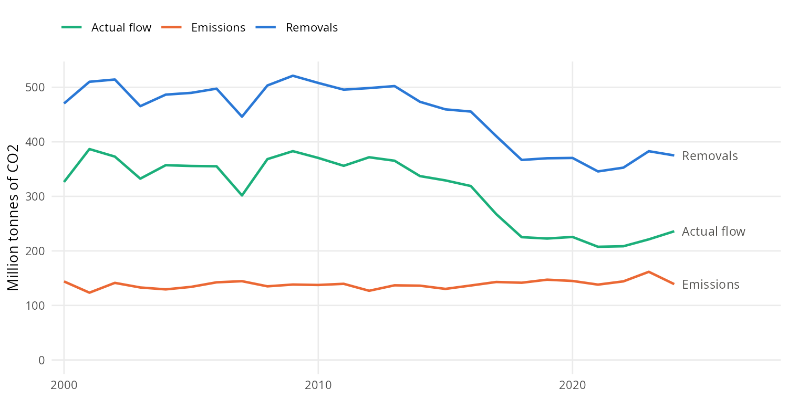
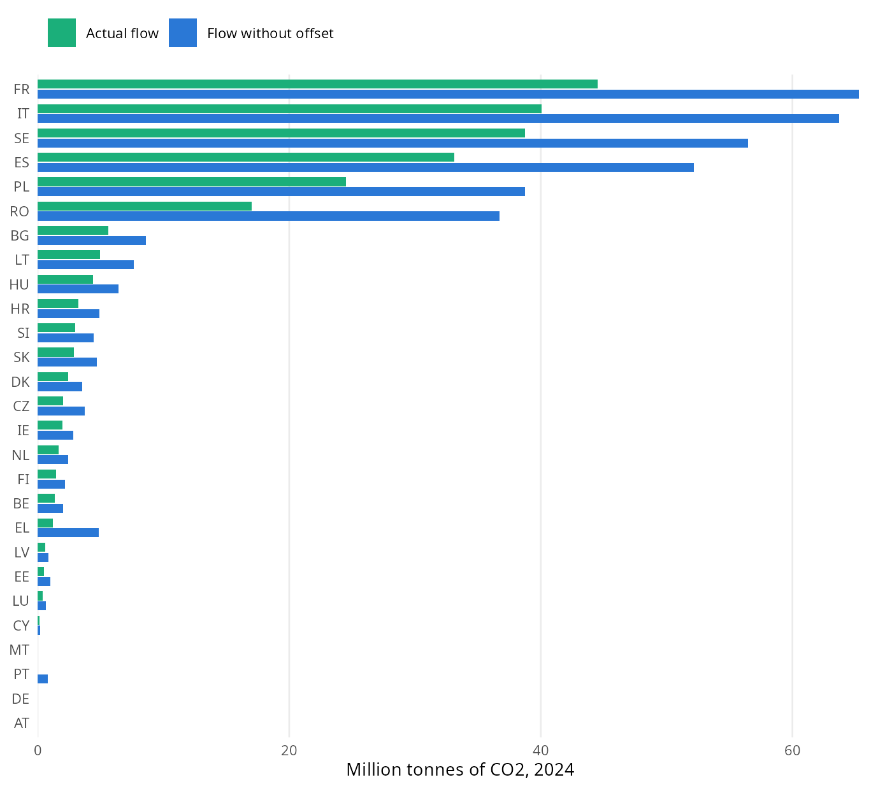
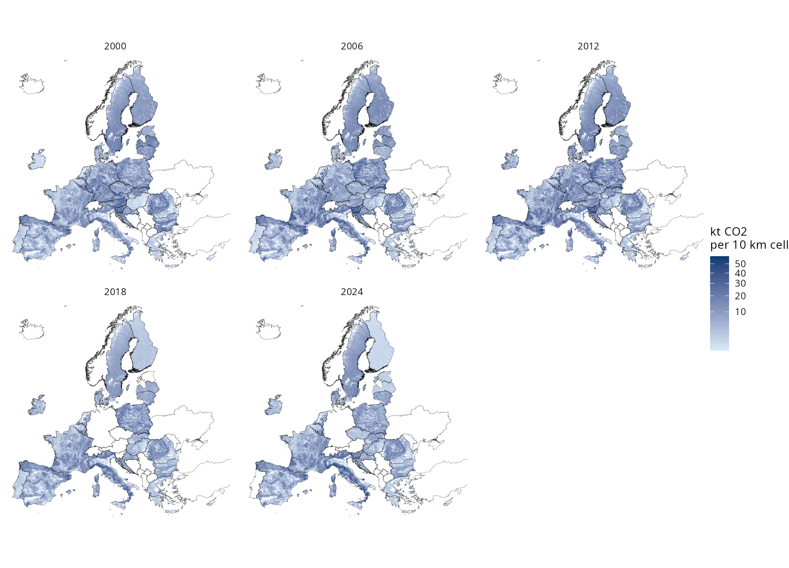
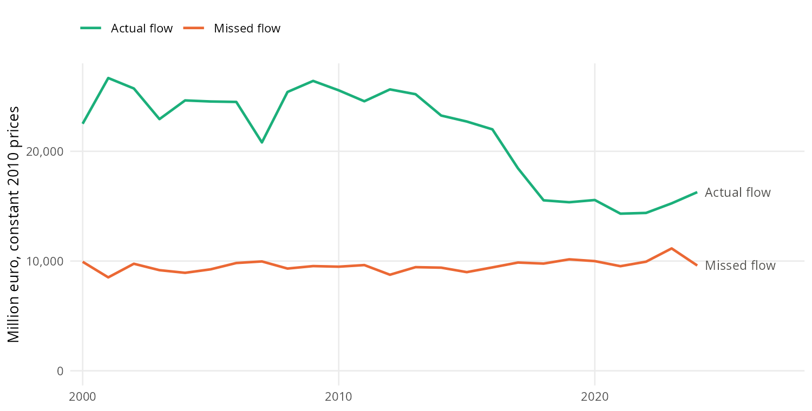

```{r}
#| label: setup
#| include: false

source("scripts/helpers_report.R", encoding = "UTF-8")

territory <- read_report("territory")
series <- read_report("eu_series")
categories <- read_report("balance_by_category")
gaps <- read_report("category_gaps")
residual <- read_report("residual_reporters")
sources <- read_report("forest_sources")
crf4 <- read_report("crf4_check")
published <- read_report("published_flow")
by_country <- read_report("flow_by_country")
counts <- read_report("country_counts")
sector_year <- read_report("sector_by_year")
sector_gaps <- read_report("sector_gaps")
comparison <- read_report("allocation_comparison")
price <- read_report("carbon_price")
deflators <- read_report("deflators")
value_series <- read_report("value_eu_series")
value_country <- read_report("value_by_country")
benchmark <- read_report("benchmark_2012")
regions <- read_report("top_regions_2024")
fallback <- read_report("nuts_fallback")
map_totals <- read_report("map_totals")
forest_area <- read_report("forest_area")
gdmp <- read_report("gdmp_comparison")
gdmp_forest <- read_report("gdmp_on_forest")
without_forest <- read_report("countries_without_forest")
totals_100m <- read_report("maps_100m_totals")

in_series <- function(y) filter(series, year == y)
in_value <- function(y) filter(value_series, year == y)
category_mt <- function(code, y) categories$balance_mt[categories$src_crf == code & categories$year == y]
country_row <- function(code, y = 2024) filter(by_country, geo == code, year == y)
compare_row <- function(code, y = 2024) filter(comparison, geo == code, year == y)
value_row <- function(code, y = 2024) filter(value_country, geo == code, year == y)
compare_year <- comparison |>
  group_by(year) |>
  summarise(
    flow = sum(flow) / 1000, flow_earlier = sum(flow_earlier) / 1000, hwp = sum(hwp_sink) / 1000,
    negative_earlier = sum(missed_earlier < -1e-9), negative = sum(missed < -1e-9), .groups = "drop"
  )
compare_at <- function(y) filter(compare_year, year == y)
flows_2024 <- by_country |> filter(year == 2024) |> arrange(desc(flow))
top_five <- 100 * sum(head(flows_2024$flow, 5)) / sum(flows_2024$flow)
price_2023 <- price$price_2023[1]
top_sector <- function(y) { s <- filter(sector_year, year == y); s$sector[which.max(s$allocated_mt)] }
largest_100m_gap <- max(abs(totals_100m$difference_pct))
```

# Summary {.unnumbered}

We provide estimates of the carbon sequestration ecosystem service for the 27 Member States of the European Union in 2000, 2006,
2012, 2018 and 2024, following the accounting method of @vallecillo2019 and its update in @lanotte2021. In 2024, land removes
`r num(in_series(2024)$removals / 1000)` million tonnes of CO2 and emits `r num(in_series(2024)$emissions / 1000)` million tonnes.
The actual flow that reaches society after this offset is `r num(in_series(2024)$net_flow / 1000)` million tonnes, against
`r num(in_series(2000)$net_flow / 1000)` million tonnes in 2000, and it is worth `r num(in_value(2024)$constant / 1000)` billion
euro at constant 2010 prices. The missed flow, which is the part of the removals used up by those emissions, is worth
`r num(in_value(2024)$missed_constant / 1000)` billion euro. The value rests on a social cost of carbon of EUR 343.6 per tonne of
carbon, which is EUR `r num(price_2023)` per tonne of CO2, in 2023 euros.

# Introduction

Carbon sequestration is the uptake of carbon dioxide (CO2) from the atmosphere by ecosystems, mainly through the growth of trees,
which stores carbon in biomass and soil. Ecosystem accounting treats it as a contribution to global climate regulation that benefits
society as a whole. Ecosystems also release CO2, so the accounts need to separate what land removes from what land emits, and to
establish how much of the removals is left once those emissions are compensated [@lanotte2021].

This report describes how we estimated those quantities and valued them, why we took each decision along the way and what the
estimates show. The calculations are carried out by a series of scripts in the folder <https://github.com/renatovargas/jrc-carbon-sequestration/tree/main/scripts>, listed in
@tbl-scripts in the order in which they run. Each step of the Methods section points to the entry of its script in Annex I, which explains what the script does and links to its code. The file
[run_all.R](#script-run-all) runs the whole series or any of its stages, and any single script can run again when only one input changes.
The tables and the 100 m maps can be retrieved from the Downloads page of this site.

| Script | Purpose |
|:----|:-----|
| [01_prepare_nuts.R](#script-01) | Country boundaries |
| [02_download_eurostat.R](#script-02) | CO2 inventory by source sector |
| [03_download_hicp.R](#script-03) | Consumer price index |
| [04_prepare_clc.R](#script-04) | Forest share at 1 km and land type areas by region |
| [05_prepare_gdmp.R](#script-05) | Annual productivity at 1 km |
| [06_prepare_nuts_weights.R](#script-06) | Share of each region in the weight of each land type |
| [07_prepare_carbon_price.R](#script-07) | Carbon price series |
| [08_build_physical_accounts.R](#script-08) | Removals, emissions, actual flow, missed flow and sector allocation |
| [09_build_monetary_accounts.R](#script-09) | Value of the flows, regional results and the workbook |
| [10_write_maps_1km.R](#script-10) | Maps at 1 km |
| [11_write_maps_100m.R](#script-11) | Maps at 100 m |
| [12_check_maps_100m.R](#script-12) | Comparison of the 100 m maps with the tables |

: Scripts of the pipeline, in the order in which they run. {#tbl-scripts}

The terms in @tbl-terms recur throughout the report.

| Term | Meaning in this report |
|:---|:-----|
| LULUCF | Land use, land use change and forestry, the part of the greenhouse gas inventory that reports the CO2 exchanged between land and the atmosphere. |
| Removal | CO2 taken up by a land category in a country and year, when the category is a net sink. |
| Emission | CO2 released by a land category in a country and year, when the category is a net source. |
| Offset | The netting of all emissions of land against all removals, at the level of the European Union. |
| Actual flow | The net CO2 that ecosystems deliver to society after the offset. |
| Flow without offset | The total removals of the land categories, before their emissions are subtracted. |
| Missed flow | The flow without offset minus the actual flow, which is the part of the removals that compensates the emissions of land use. |
| GDMP | Gross Dry Matter Productivity, the rate at which vegetation produces dry matter, estimated from satellite images. |
| NUTS | The European classification of territorial units, where NUTS0 is the country level. |

: Key terms of the report. {#tbl-terms}

# Methods

## Overview

National greenhouse gas inventories report CO2 by country, and they do not report it by place. The accounts therefore work in two
stages. They first build the national and regional values, which is a statistical problem, and they then place the national values on
a map, which is a spatial problem. Monetary values follow from the physical ones through a price per tonne.

The analysis covers the EU27, with `r territory$nuts2` NUTS2 regions and `r territory$nuts3` NUTS3 regions under the NUTS 2024
boundaries [@gisco2024nuts], and maps use the projection EPSG:3035, in which every cell covers the same area on the ground (see
[01_prepare_nuts.R in Annex I](#script-01)).

## Removals and emissions

We took CO2 by source sector from the Eurostat dataset `env_air_gge` [@eurostat2026envairgge], in the release retrieved on
`r territory$inventory_retrieved`, for the 27 Member States and the EU27 aggregate (see [02_download_eurostat.R in Annex I](#script-02)). Following
@vallecillo2019, the land categories are forest land, cropland, grassland, wetlands, settlements and other land, which are the codes
`CRF4A` to `CRF4F`.

The inventory uses the point of view of the atmosphere, so a negative value is CO2 removed and a positive value is CO2 released. The
accounts reverse the sign, so that a positive balance $b$ of category $k$ in country $c$ is uptake. The removals $R$ and emissions $E$
are the two parts of that balance.

$$
R_{k,c} = \max(b_{k,c},\, 0), \qquad E_{k,c} = \max(-b_{k,c},\, 0)
$$ {#eq-split}

A category that is a net source in a year therefore counts fully as an emission and adds nothing to the removals of that year. Forest
land is a net source in several countries, as @tbl-sources shows for the reporting years. A category that a country does not report is
set to zero and listed. Among the six land categories, this concerns only other land in Denmark, in
`r gaps$years_missing[gaps$geo == "DK" & gaps$src_crf == "CRF4F"]` years. The residual category `CRF4H`, which `r residual$countries`
of the 27 countries report, stays outside the account. The calculations of this section and the next two are carried out by the same script (see
[08_build_physical_accounts.R in Annex I](#script-08)).

```{r}
#| label: tbl-sources
#| tbl-cap: "Countries where forest land is a net source of CO2 in the reporting years, in thousand tonnes of CO2."

sources |>
  transmute(Year = as.integer(year), Country = geo, `Balance of forest land (kt CO2)` = balance_kt) |>
  show_table(digits = 0)
```

### Harvested wood products

The inventory reports the change in the stock of harvested wood products as its own category, `CRF4G`. A deduction of that sink from
the removals of forest land is one possible treatment, since the carbon in harvested wood has left the forest. The carbon chapters of
@vallecillo2019 and @lanotte2021 take forest uptake from the inventory as reported and make no such deduction, and the handbook of
Eurostat keeps these products out of net sequestration as a separate category [@eurostat2026handbook, para. 9.56]. A decision was
therefore made not to deduct them. The sink stays outside the flow as a memo item, at `r num(category_mt("CRF4G", 2024))` million tonnes
in 2024.

## The offset and the actual flow

@lanotte2021 define the service that reaches society as the balance of removals and emissions over all ecosystem types at the level
of the European Union, so an ecosystem type with more emissions than removals provides no service. The EU net flow is computed once.

$$
N = \sum_{k,c} R_{k,c} - \sum_{k,c} E_{k,c}
$$ {#eq-net}

@lanotte2021 then attribute this net flow to each country $c$ in proportion to its removals of forest land $R_{F,c}$, in their Equation
6.1.

$$
F_c = N \, \frac{R_{F,c}}{\sum_{c} R_{F,c}}
$$ {#eq-flow}

The flow without the offset $W_c$ of a country is the sum of its removals over the six land categories, and the missed flow $M_c$ is the
difference between that and the actual flow.

$$
W_c = \sum_{k} R_{k,c}, \qquad M_c = W_c - F_c
$$ {#eq-missed}

At the level of the European Union, the missed flow equals total emissions by construction. The definition follows from
the distinction that @lanotte2021 draw between the role of forests, shown by removals, and the contribution to society, shown by the
actual flow.

### Choice of the allocation key

Net annual increment, which is the growth of living trees minus natural mortality, is another candidate for the key in
@eq-flow, because it measures forest growth and does not depend on the sign of the inventory. We compared the two approaches in a run
that used net annual increment of all forest from Eurostat [@eurostat2026forvolefa] and also deducted harvested wood products
(@tbl-comparison). That run assigned a flow to countries whose forest land was a net source, including
`r num(compare_row("DE")$flow_earlier / 1000)` million tonnes to Germany in 2024, and it left between
`r min(compare_year$negative_earlier)` and `r max(compare_year$negative_earlier)` countries with a negative missed flow in each
reporting year, which has no direct reading as a service that is not delivered. The series of net annual increment also carried breaks between
years, and very few countries had reported it for 2024, so most of the key of that year would have repeated earlier values.

A decision was made to follow Equation 6.1. Under this key no country has a negative missed flow, and a country whose forest land is a
net source receives no flow, which agrees with the definition of the service. The comparison was run once, so the pipeline does not repeat
it, and the table keeps its result. The sink in that table adds up the countries where the category is a sink, so it is slightly larger
than the net balance of the category that the text above and @tbl-categories report.

```{r}
#| label: tbl-comparison
#| tbl-cap: "EU27 actual flow under the method of this report and under the compared run, in million tonnes of CO2, with the number of countries with a negative missed flow."

compare_year |>
  transmute(
    Year = as.integer(year), `Actual flow, this report` = flow, `Actual flow, compared run` = flow_earlier,
    `Harvested wood products sink` = hwp, `Negative missed flow, this report` = negative,
    `Negative missed flow, compared run` = negative_earlier
  ) |>
  show_table(digits = 1)
```

## Allocation to emitting sectors

@vallecillo2019 complement the accounts with a table that attributes the flow of each country to the economic sectors in proportion to
their share of its total CO2 emissions, which shows which sectors the service offsets. The allocation does not change the flow. We grouped
the source categories of the inventory into energy supply, manufacturing and construction, transport, agriculture, forestry and fishing,
households, services and other, and waste. These keep the sector names of the inventory, which differ from the industries of the national
accounts, as the fuel that households burn in their cars is reported under transport.

## Regional values

NUTS2 and NUTS3 regions receive a share of the national values (see [06_prepare_nuts_weights.R in Annex I](#script-06) for the shares, and
[09_build_monetary_accounts.R in Annex I](#script-09) for the regional results). The actual flow of a region is the national flow times the share of the
region in the forest weight of its country, which is the spatial key described below. The flow without the offset of a region adds up the
removals of the six land categories, each shared in proportion to the area of that category in the region according to the Corine
accounting layer of the year. The missed flow of a region is the difference between the two. When a country has no mapped area of a
category, the share of the region in the total mapped land of the country stands in. This concerns only
`r paste(unique(fallback$geo), collapse = " and ")`.

## Monetary valuation

The value of a flow is the flow in tonnes of CO2 multiplied by a price per tonne. The accounts need a price for the damage avoided by a
tonne of CO2 that stays out of the atmosphere. @vallecillo2019 use the benchmark of EUR 30 per tonne of CO2 from @oecd2016, which they
describe as a reference point and as a lower-end estimate. A decision was made to use a social cost of carbon instead, which is the
value of the damage that one additional tonne causes, because it reflects the long-term damage of climate change and does not depend on
the conditions of a carbon market in a given year.

The value draws on the meta-analysis of published estimates by @tol2023. That work standardises every estimate to 2010 US dollars per tonne
of carbon, for emissions in 2010 [@tol2022], and its update finds a weighted mean of 207 US$ per tonne of carbon, which rises to between 231
and 253 US$ when older studies are discounted [@tol2025]. A decision was made to adopt 266 US$ per tonne of carbon in 2010 prices, which lies
just above that range and well below the kernel mean of 509 US$ in @tol2022, whose long right tail reflects the large uncertainty of these
estimates. We moved it to 2023 prices with the consumer price index of the United States [@bls2023cpi], a factor of 304.70/218.06, and to
euros at the rate of 1.0813 US$ per euro in 2023 [@ecb2023usd]. Those steps lead to about EUR 344, and the accounts use EUR 343.6 per tonne
of carbon. One tonne of CO2 holds 12/44 of a tonne of carbon, so the price is EUR `r num(price_2023)` per tonne of CO2 in 2023 euros (see [07_prepare_carbon_price.R in Annex I](#script-07)).

The social cost of carbon is a single real value, so we held it constant in 2023 euros and moved it to the prices of each year $t$ with
the harmonised index of consumer prices $H$ of the European Union [@eurostat2026hicp] (see [03_download_hicp.R in Annex I](#script-03)). Constant prices of 2010
remove general inflation, so values of different years can be compared.

$$
P_t = P_{2023}\, \frac{H_t}{H_{2023}}, \qquad V^{\text{current}}_{c,t} = F_{c,t}\, P_t, \qquad
V^{\text{constant}}_{c,t} = V^{\text{current}}_{c,t}\, \frac{H_{2010}}{H_t}
$$ {#eq-value}

The price moves from EUR `r num(price$price_current[price$year == 2000])` per tonne of CO2 in 2000 to EUR
`r num(price$price_current[price$year == 2024])` in 2024 in current prices. The missed flow is valued in the same way (see
[09_build_monetary_accounts.R in Annex I](#script-09)). The handbook of Eurostat does not value this service [@eurostat2026handbook].

## Maps

### The spatial key

@vallecillo2019 map forest land only, since it is the one ecosystem type for which almost all countries report uptake, and they spread the
national values with dry matter productivity over the woodland and forest of Corine Land Cover. We followed that approach, with the two more
recent products that the Earth observation roadmap of the same programme names [@zurbaran2025].

Forest comes from the Corine accounting layers, which the European Environment Agency prepares for comparison between years, in version 21 for
all five years [@eea2026clcacc]. The classes are broad-leaved forest (311), coniferous forest (312), mixed forest (313) and transitional
woodland and shrub (324). We reduced them from 100 m to the share of each 1 km cell (see [04_prepare_clc.R in Annex I](#script-04)).

Productivity is the annual sum of the 36 ten-day GDMP values of the Copernicus Land Monitoring Service, each multiplied by its number of days.
The 1 km product, version 2, covers 2000, 2006 and 2012 [@copernicus2020gdmp1km], and it ends in 2020. The 300 m product, version 2, covers 2018 and
2024 [@copernicus2020gdmp300], and it starts in 2014 (see [05_prepare_gdmp.R in Annex I](#script-05)). Since 2018 exists in both, we compared them over
`r num(gdmp$forest_cells / 1e6)` million cells that are mostly forest. The correlation is `r num(gdmp$pearson, 3)`, and the mean of the 300 m product is
`r num(100 * gdmp$ratio_of_means, 1)` percent of the mean of the 1 km product. Weights only share a national value among the cells of a country, so a
difference in level between the products changes no national total. The comparison was run once, and the pipeline keeps its result only when the
1 km product of 2018 is available.

The weight of a cell $i$ is its forest share $S_i$ times its annual productivity $G_i$, and each cell receives its part of the national value.

$$
F_i = F_c\, \frac{S_i\, G_i}{\sum_{i \in c} S_i\, G_i}
$$ {#eq-spread}

### Products

We wrote the maps at 1 km, which are a working product kept outside the repository, and at 100 m, which are the published product (see
[10_write_maps_1km.R in Annex I](#script-10) and [11_write_maps_100m.R in Annex I](#script-11)). At 100 m the forest share is 1 for a forest cell and 0 otherwise, and productivity
is interpolated bilinearly to the grid. There are three maps for each reporting year. The first is the actual flow, in thousand tonnes of CO2 per
cell. The second is its value, in million euro at constant 2010 prices per cell. The third is the flow without the offset, for which a decision was
made to map the removals of forest land, following @vallecillo2019, because other land categories switch between source and sink across years and
countries. This map therefore holds less than the flow without the offset in the tables. In 2024 the difference is
`r num(in_series(2024)$removals / 1000 - map_totals$no_offset_map_mt[map_totals$year == 2024])` million tonnes, which the tables report by region.
The missed flow is a balance between removals and emissions and has no place of its own on the land, so a decision was made to report it in tables only.

## Checks

The scripts stop if any check fails. @tbl-checks records the largest gap of each check. The sectors differ from total emissions without land use only
for `r sector_gaps$geo[1]` in `r sector_gaps$year[1]`, where the inventory holds `r num((sector_gaps$total[1] - sector_gaps$parts[1]) / 1000)` million
tonnes in the total that it does not hold in the sectors, and this year is not one of the reporting years. The total of land use, `CRF4`, equals the
sum of its parts in the reporting years, with a largest difference of `r num(max(abs(crf4$difference)), 2)` thousand tonnes.

```{r}
#| label: tbl-checks
#| tbl-cap: "Consistency checks, with the largest gap and the tolerance that would stop the scripts. Gaps are relative unless they are marked as absolute."

bind_rows(read_report("checks_physical"), read_report("checks_monetary"), read_report("checks_maps"), read_report("checks_maps_100m")) |>
  transmute(Check = check, `Largest gap` = formatC(largest_gap, format = "e", digits = 1),
            Tolerance = formatC(tolerance, format = "e", digits = 0), Type = if_else(relative, "Relative", "Absolute")) |>
  show_table()
```

We read the maps back from disk to compare them with the tables. At 1 km, the forest area of the grid is `r num(forest_area$grid_mha[forest_area$epoch == "2024"])`
million hectares in 2024, the same as in the table of regions. At 100 m, the largest difference from the tables in any year is
`r format(largest_100m_gap, digits = 2)` percent (see [12_check_maps_100m.R in Annex I](#script-12)). The number of countries that hold a flow and lack forest cells, which would lose that flow on the map, is `r nrow(without_forest)`.

# Results

## Removals, emissions and actual flow

Forest land provides `r num(100 * map_totals$no_offset_map_mt[map_totals$year == 2024] / (in_series(2024)$removals / 1000), 0)` percent of the removals in 2024, and the other five land categories are net emitters at the level of the European Union (@tbl-categories). The balance of forest
land falls from `r num(category_mt("CRF4A", 2012))` million tonnes in 2012 to `r num(category_mt("CRF4A", 2018))` million tonnes in 2018, and that
fall drives the series (@fig-series). Emissions change much less. As a result, the actual flow falls from `r num(in_series(2012)$net_flow / 1000)` to
`r num(in_series(2018)$net_flow / 1000)` million tonnes between the same years, and then recovers to `r num(in_series(2024)$net_flow / 1000)` million tonnes in
2024. Values of recent years may change with new releases of the inventory.

```{r}
#| label: tbl-categories
#| tbl-cap: "Signed balance by category in the EU27, in million tonnes of CO2, with uptake as positive. The last two categories stay outside the flow."

categories |>
  select(Category = category, year, balance_mt) |>
  pivot_wider(names_from = year, values_from = balance_mt) |>
  show_table(digits = 1)
```

```{r}
#| label: tbl-eu
#| tbl-cap: "Flow without offset, emissions, actual flow and missed flow in the EU27, in million tonnes of CO2."

series |>
  filter(year %in% c(2000, 2006, 2012, 2018, 2024)) |>
  transmute(Year = as.integer(year), `Flow without offset` = removals / 1000, Emissions = emissions / 1000,
            `Actual flow` = net_flow / 1000, `Missed flow` = missed_flow / 1000) |>
  show_table(digits = 1)
```

{#fig-series width=100%}

## Countries

Under @eq-flow, the actual flow of a country follows its forest removals, so the flow is concentrated. Five countries hold
`r num(top_five, 0)` percent of the actual flow in 2024, led by `r paste(head(flows_2024$geo, 5), collapse = ", ")` (@tbl-countries and @fig-countries). In 2024
`r counts$no_forest_removals[counts$year == 2024]` countries have no forest removals, and in 2018 there are
`r counts$no_forest_removals[counts$year == 2018]`, whereas no country is in that position in 2000, 2006 or 2012. These countries have no actual flow in those
years. Germany held `r num(country_row("DE", 2012)$flow / 1000)` million tonnes in 2012, and it holds none in 2018 or 2024.

```{r}
#| label: tbl-countries
#| tbl-cap: "Accounts by country in 2024, in thousand tonnes of CO2, with values in million euro at constant 2010 prices."

by_country |>
  filter(year == 2024) |>
  left_join(filter(value_country, year == 2024), by = c("geo", "year")) |>
  arrange(desc(flow)) |>
  transmute(Country = geo, `National balance` = national_balance, `Flow without offset` = flow_no_offset, `Actual flow` = flow,
            `Missed flow` = missed_flow, `Value of actual flow` = value_constant_meur, `Value of missed flow` = missed_value_constant_meur) |>
  show_table(digits = 0)
```

{#fig-countries width=85%}

## Regions

The workbook holds every quantity at NUTS0, NUTS2 and NUTS3. @tbl-regions lists the NUTS2 regions with the largest actual flow in 2024, which are the
large forest regions of the countries with the highest removals.

```{r}
#| label: tbl-regions
#| tbl-cap: "NUTS2 regions with the largest actual flow in 2024, in thousand tonnes of CO2, with the value in million euro at constant 2010 prices."

regions |>
  transmute(Code = nuts_id, Region = name, `Actual flow` = flow, `Flow without offset` = flow_no_offset, `Missed flow` = missed_flow,
            `Value of actual flow` = flow_constant) |>
  show_table(digits = 0)
```

## Maps

@fig-flow-maps shows the actual flow, drawn at 10 km so that it reads at this size. Forest regions of high productivity stand out within each country, and
the differences between countries reflect their national values, so borders can show as steps in the map. @vallecillo2019 note the same effect. Countries with no forest removals in a year appear blank in that panel, as Germany does in 2018 and 2024. The mean
productivity on forest rises from `r num(gdmp_forest$mean_gdmp_on_forest[gdmp_forest$year == 2012], 0)` to
`r num(gdmp_forest$mean_gdmp_on_forest[gdmp_forest$year == 2018], 0)` kilograms per hectare between 2012 and 2018, although the 300 m product runs below the 1 km product in the year they share, so the change of product does not explain the rise. Productivity only
places values within a country, so this has no effect on national totals. The value maps in @fig-value-maps follow the same pattern, since they multiply the flow by one price per year.

{#fig-flow-maps width=100%}

{#fig-value-maps width=100%}

## Value

The actual flow is worth `r num(in_value(2024)$constant / 1000)` billion euro in 2024 at constant 2010 prices, and `r num(in_value(2024)$current / 1000)` billion euro in current
prices (@tbl-value and @fig-value). Constant values follow the physical flow, because the real price is fixed. The missed flow is worth between
`r num(min(value_series$missed_constant[value_series$year %in% c(2000, 2006, 2012, 2018, 2024)]) / 1000)` and `r num(max(value_series$missed_constant[value_series$year %in% c(2000, 2006, 2012, 2018, 2024)]) / 1000)` billion euro in the reporting years, since emissions change little.

```{r}
#| label: tbl-value
#| tbl-cap: "Value in the EU27, in million euro."

value_series |>
  filter(year %in% c(2000, 2006, 2012, 2018, 2024)) |>
  transmute(Year = as.integer(year), `Actual flow, current prices` = current, `Actual flow, constant 2010 prices` = constant,
            `Missed flow, constant 2010 prices` = missed_constant) |>
  show_table(digits = 0)
```

{#fig-value width=100%}

## Sectors

@tbl-sectors shows the actual flow attributed to the sectors that emit CO2. The largest part goes to `r tolower(top_sector(2012))` in 2012 and to `r tolower(top_sector(2024))` in 2024. The attribution follows the emissions of each country weighted by its flow, so it also shifts when the flow moves between countries.

```{r}
#| label: tbl-sectors
#| tbl-cap: "Actual flow attributed to emitting sectors in the EU27, in million tonnes of CO2."

sector_year |>
  pivot_wider(names_from = year, values_from = allocated_mt) |>
  rename(Sector = sector) |>
  arrange(desc(`2024`)) |>
  show_table(digits = 1)
```

## Comparison with the published accounts

@lanotte2021 report an actual flow of 306 million tonnes of CO2 in 2012 in their main tables, and 303 million tonnes in one passage of the text, from forest removals of 444 million
tonnes. We obtain `r num(in_series(2012)$net_flow / 1000)` million tonnes (@tbl-published). The comparison serves for orientation only, because they report the EU-28 with an earlier
release of the inventory, and countries revise past years in each release. The price also differs by design. Their flow of 2012 is valued at 9,189 million euro, which implies EUR
`r num(benchmark$price_published)` per tonne, whereas the price here in 2012 is EUR `r num(benchmark$price_here)` per tonne in current prices.

```{r}
#| label: tbl-published
#| tbl-cap: "Actual flow in this report (EU27) and in La Notte et al. (2021), Table 6.7 (EU-28), in million tonnes of CO2."

published |>
  transmute(Year = as.integer(year), `This report` = here_mt, Published = published_mt, `Difference (%)` = difference_pct) |>
  show_table(digits = 1)
```

# Limitations

**Inventories.** Countries produce their inventories with their own methods and definitions, so comparisons between countries call for caution [@vallecillo2019]. They revise them every year,
which changes the values of past years between releases. Some sharp changes between years may reflect these methods as well as forests, and we did not separate the two.

**Actual flow.** The flow of a country depends on the removals and emissions of all countries, because the offset is computed once for the European Union, and it should not be read as a national
balance. The tables show that balance separately. A category counts as a removal or an emission according to its net sign in each country and year, so the gross fluxes inside a category are not
visible. Countries with no forest removals in a year receive no flow, so their value can change abruptly between years when their forest moves between source and sink. Harvested wood products
stay outside the flow, and including them as a deduction would lower the removals of forest land by up to the sink in @tbl-comparison.

**Maps.** The spatial key combines where forest is located with the productivity of the vegetation, which is a proxy for where removals happen. Productivity measures growth and does not measure the net
carbon balance, so it does not capture the carbon in soils or the age of stands. The maps of 2000, 2006 and 2012 use a 1 km product and those of 2018 and 2024 a 300 m product, so the spatial detail of the
two groups differs. The Corine accounting layers have a minimum mapping unit of 25 hectares. Maps and regional values allocate a national value, so they should not be read as independent local estimates.
The map of the flow without the offset covers forest land only.

**Value.** The value depends directly on the price. The social cost of carbon is a model-based estimate that is sensitive to assumptions such as the discount rate and the damage function. This literature quotes estimates per tonne of carbon and per tonne of CO2, which differ by a factor of 44/12, and the value adopted here is per tonne of carbon, the unit in which the meta-analysis standardises its estimates. The real price is about `r num(price_2023 / 30, 0)` times the benchmark of earlier accounts, so the values cannot be compared with those accounts. It also differs from a market price. A consumer price index for the whole European Union converts values to constant prices, so differences in inflation between countries are ignored.

# References {.unnumbered}

::: {#refs}
:::



# Annex I. Scripts of the pipeline {.unnumbered}

This annex describes each script in the order in which it runs. The link under each name opens its code on GitHub, and the paragraph explains
what the script takes in, what it does and what it saves for the steps that follow. Scripts 01 to 07 prepare the inputs, and several of them need
large source files that are kept outside the repository. Scripts 08 to 10 run from the repository alone. Scripts 11 and 12 write and check the
100 m maps, and they need the large source files again.

## 01_prepare_nuts.R {#script-01 .unnumbered .unlisted}

[View on GitHub](https://github.com/renatovargas/jrc-carbon-sequestration/blob/main/scripts/01_prepare_nuts.R)

This script takes the NUTS 2024 boundaries of Eurostat at a scale of 1:1 million [@gisco2024nuts], in the copy distributed with the INCA plugin, and
keeps only the level of countries. It marks the 27 Member States and stops if it does not find all of them. The result is a small file,
`NUTS_RG_01M_2024_3035_LEVL0.gpkg`, which the later scripts use to identify the countries and to draw the maps, and the copyright notice of the
boundaries is copied next to it.

## 02_download_eurostat.R {#script-02 .unnumbered .unlisted}

[View on GitHub](https://github.com/renatovargas/jrc-carbon-sequestration/blob/main/scripts/02_download_eurostat.R)

This script downloads the CO2 emissions and removals by source sector from the Eurostat dataset `env_air_gge` [@eurostat2026envairgge] through the
Eurostat data service. It keeps the values in thousand tonnes for the 27 Member States and the EU27 aggregate from 1990 to 2024, drops the rows
with no reported value and records the date of the download. The table is saved as `env_air_gge_co2.rds` for the physical accounts. A new release of
the dataset changes the results, so this step runs only when an update is intended.

## 03_download_hicp.R {#script-03 .unnumbered .unlisted}

[View on GitHub](https://github.com/renatovargas/jrc-carbon-sequestration/blob/main/scripts/03_download_hicp.R)

This script downloads the annual harmonised index of consumer prices of the EU27, for all items and with 2015 as its base [@eurostat2026hicp]. The
series is saved as `hicp_eu27.rds`, which the carbon price and the constant prices of the monetary accounts use.

## 04_prepare_clc.R {#script-04 .unnumbered .unlisted}

[View on GitHub](https://github.com/renatovargas/jrc-carbon-sequestration/blob/main/scripts/04_prepare_clc.R)

This script reads the Corine Land Cover accounting layers at 100 m for the five reporting years [@eea2026clcacc] and groups their classes into the six
land categories of the inventory, leaving water bodies out. It reduces each layer to the share of every 1 km cell covered by each category. The forest share of each year is saved as
`CLC<year>_forest_pct_1km.tif`, in whole percentages, which brings a layer of about 175 MB down to a file of under 4 MB. The
script then adds up the hectares of each category in every country and in every NUTS2 and NUTS3 region, and it saves them as
`clc_ecosystem_area_by_nuts.rds`. The later scripts use these files to weigh regions and cells.

## 05_prepare_gdmp.R {#script-05 .unnumbered .unlisted}

[View on GitHub](https://github.com/renatovargas/jrc-carbon-sequestration/blob/main/scripts/05_prepare_gdmp.R)

This script builds the annual productivity that places the flow on the map. For each year it reads the 36 ten-day files of Gross Dry Matter Productivity
from the Copernicus data store, using the 1 km product for 2000, 2006 and 2012 [@copernicus2020gdmp1km] and the 300 m product for 2018 and 2024
[@copernicus2020gdmp300]. It keeps the part of each file that covers Europe, multiplies each daily rate by the number of days it represents, counts missing
cells as zero and adds up the year. This annual file stays outside the repository at its original resolution for the 100 m maps, and a copy on the 1 km grid of the
accounts is saved as `GDMP_<year>_1km.tif`. Because 2018 exists in both products, the script also compares them over the cells that are mostly forest and
saves the result as `gdmp_comparison.rds` for the report. The store requires a free Copernicus account only when an annual file has to be built again.

## 06_prepare_nuts_weights.R {#script-06 .unnumbered .unlisted}

[View on GitHub](https://github.com/renatovargas/jrc-carbon-sequestration/blob/main/scripts/06_prepare_nuts_weights.R)

This script works out the share of each NUTS2 and NUTS3 region in the national total of each land category. The weight of forest is the forest share of
each 1 km cell times its productivity in the same year, added up over the region, and the weight of the other categories is their area in hectares. When a
country has no mapped area of a category, the share of the region in the total mapped land of the country stands in, and the row is marked. The shares are
saved as `clc_type_weight_by_nuts.rds`, which the monetary accounts use to build the regional results.

## 07_prepare_carbon_price.R {#script-07 .unnumbered .unlisted}

[View on GitHub](https://github.com/renatovargas/jrc-carbon-sequestration/blob/main/scripts/07_prepare_carbon_price.R)

This script sets the social cost of carbon at EUR 343.6 per tonne of carbon in 2023 euros, based on @tol2023, and converts it to tonnes of CO2 with the
ratio of 12/44. It holds that value constant in real terms and moves it to the prices of each year from 2000 to 2024 with the consumer price index. The
series is saved as `carbon_price.rds` for the monetary accounts.

## 08_build_physical_accounts.R {#script-08 .unnumbered .unlisted}

[View on GitHub](https://github.com/renatovargas/jrc-carbon-sequestration/blob/main/scripts/08_build_physical_accounts.R)

This script builds the physical accounts for every year from 2000 to 2024, following @vallecillo2019 and @lanotte2021. It reverses the sign of the
inventory, separates the removals and emissions of each land category in each country and computes the net flow once for the European Union. It attributes
that flow to countries in proportion to their removals of forest land, and it derives the flow without the offset and the missed flow. It then shares the flow of each country
among the sectors that emit CO2. The script checks that countries add up to the Eurostat aggregate, that shares add up to one and that the flows agree with
each other, and it stops if any check fails. The results are saved as `carbon_lulucf_country_year.rds`, `carbon_flow_country_year.rds` and
`carbon_sector_allocation_country_year.rds`, together with the small tables and the figures of the report.

## 09_build_monetary_accounts.R {#script-09 .unnumbered .unlisted}

[View on GitHub](https://github.com/renatovargas/jrc-carbon-sequestration/blob/main/scripts/09_build_monetary_accounts.R)

This script multiplies the physical flows by the carbon price of each year to obtain their value in current prices, and it applies the consumer price index
to express them in constant 2010 prices. For the reporting years it then shares the national values among NUTS2 and NUTS3 regions, and it stops if the
regions do not add up to their countries. The national values are saved as `carbon_value_country_year.rds`, and the tables by NUTS level form the workbook
`carbon_sequestration_results.xlsx` on the Downloads page. The small tables and the value figure of the report are saved as well.

## 10_write_maps_1km.R {#script-10 .unnumbered .unlisted}

[View on GitHub](https://github.com/renatovargas/jrc-carbon-sequestration/blob/main/scripts/10_write_maps_1km.R)

This script places the national values on a 1 km grid for each reporting year. The weight of a cell is its forest share times its productivity, and each
cell receives the national value in proportion to its weight within its country. It writes maps of the actual flow, of its value at constant 2010 prices and of the
removals of forest land, which stand for the flow without the offset. These maps are a working product kept outside the repository. The script reads them back from
disk, stops if they disagree with the tables, and saves the small tables of the checks and the two map figures of the report, drawn at 10 km.

## 11_write_maps_100m.R {#script-11 .unnumbered .unlisted}

[View on GitHub](https://github.com/renatovargas/jrc-carbon-sequestration/blob/main/scripts/11_write_maps_100m.R)

This script writes the published maps at 100 m, using the same method and the national values of the tables. It works directly from the Corine accounting layers, where
a cell counts as forest or not, and from the annual productivity of script 05, interpolated to the 100 m grid. It writes three maps for each reporting year, which
make 15 GeoTIFF files named `carbon_flow_gdmp_100m_<year>.tif`, `carbon_value_constant_gdmp_100m_<year>.tif` and `carbon_flow_no_offset_gdmp_100m_<year>.tif`. These files
are too large for the repository, so they are published in the external folder linked from the Downloads page.

## 12_check_maps_100m.R {#script-12 .unnumbered .unlisted}

[View on GitHub](https://github.com/renatovargas/jrc-carbon-sequestration/blob/main/scripts/12_check_maps_100m.R)

This script reads the 15 maps at 100 m back from disk, adds up their cells by country and compares the totals with the national tables. It stops if a country
or a year differs by more than 0.01 percent. Because the maps stay outside the repository, the script saves this record as `maps_100m_totals.rds` and
`checks_maps_100m.rds`, and the report reads it from there.

## run_all.R {#script-run-all .unnumbered .unlisted}

[View on GitHub](https://github.com/renatovargas/jrc-carbon-sequestration/blob/main/scripts/run_all.R)

This script runs the numbered scripts in order, grouped into four stages, which are the inputs (scripts 01 to 07), the tables (08 and 09), the 1 km maps (10) and the
100 m maps (11 and 12). With no stage named it runs the tables and the 1 km maps, which need only the repository.

## Helper files {#script-helpers .unnumbered .unlisted}

View on GitHub: [helpers_common.R](https://github.com/renatovargas/jrc-carbon-sequestration/blob/main/scripts/helpers_common.R),
[helpers_carbon.R](https://github.com/renatovargas/jrc-carbon-sequestration/blob/main/scripts/helpers_carbon.R),
[helpers_monetary.R](https://github.com/renatovargas/jrc-carbon-sequestration/blob/main/scripts/helpers_monetary.R),
[helpers_results.R](https://github.com/renatovargas/jrc-carbon-sequestration/blob/main/scripts/helpers_results.R) and
[helpers_report.R](https://github.com/renatovargas/jrc-carbon-sequestration/blob/main/scripts/helpers_report.R)

These files hold the steps that several scripts share, and they do not run on their own. The first holds the common work with grids, regions, saved tables and checks.
The second holds the formulas of the physical accounts and the style of the figures. The third prepares the deflator of the constant prices, the fourth builds the regional
tables and the workbook, and the fifth formats the tables of this report.
